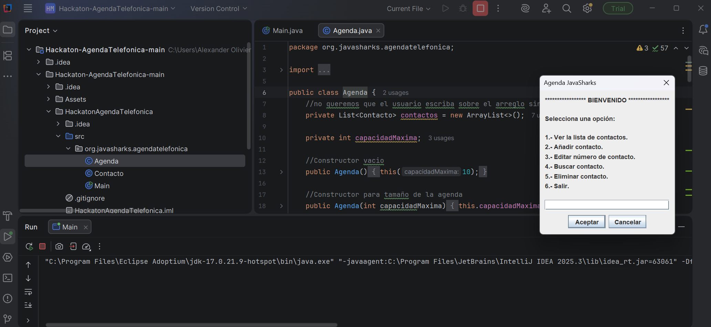

[](https://github.com/AlexanderOlivieri/Hackaton-AgendaTelefonica)

Aplicación de consola gráfica desarrollada en **Java** durante el Hackathon del equipo **JavaSharks**.

El proyecto consiste en una agenda telefónica que permite administrar contactos mediante una interfaz basada en ventanas emergentes, utilizando `JOptionPane`.

---


## 👥 Equipo JavaSharks

- **Alexander Eliseo Olivieri Angeles**
- **Aranza Monserrat Islas Castro**
- **Héctor Adrián Sánchez Arroyo**
- **Teresa Erandi Mejía Pascual**
- **Víctor Antonio Gómez Serna**

  
  [](https://github.com/AlexanderOlivieri)
  [](https://github.com/Tradick)
  [](https://github.com/Erandi-M)
  [](https://github.com/VictorSerna06)
  <!--[](https://github.com/ariislas)
  [](https://github.com/Erandi-M)-->
  
  

---



## 🎯 Objetivo del proyecto

Desarrollar una agenda telefónica funcional aplicando conceptos de **Programación Orientada a Objetos (POO)** en Java.

La aplicación permite:

- Consultar la lista de contactos.
- Agregar nuevos contactos.
- Editar números telefónicos.
- Buscar contactos por nombre.
- Eliminar contactos.
- Validar números telefónicos.
- Controlar la capacidad disponible de la agenda.

---

## 🛠️ Tecnologías utilizadas


- **Java**
- **Java Swing**
- **JOptionPane**
- **ArrayList**
- **List**
- **Programación Orientada a Objetos**
- **IntelliJ IDEA**
- **Git / GitHub**

---

## 🖥️ Interfaz de usuario

Para construir la interfaz de interacción con el usuario se utilizó **Java Swing**, específicamente la clase `JOptionPane`.

El import utilizado en `Main.java` es:

```java
import javax.swing.*;
```

Mediante `JOptionPane` se implementaron ventanas emergentes para mostrar el menú, solicitar información y presentar mensajes al usuario.

### Métodos utilizados para la interfaz

```java
JOptionPane.showInputDialog(...)
```

Se utiliza para solicitar información al usuario, como:

- Nombre del contacto.
- Número telefónico.
- Opción del menú.

```java
JOptionPane.showMessageDialog(...)
```

Se utiliza para mostrar:

- Mensajes de confirmación.
- Resultados de búsquedas.
- Errores de validación.
- Mensajes informativos.

---

# 🧩 Estructura del proyecto

El proyecto se encuentra organizado mediante paquetes y clases:

```text
src/
└── org/
    └── javasharks/
        └── agendatelefonica/
            ├── Agenda.java
            ├── Contacto.java
            └── Main.java
```

### `Contacto.java`

Representa la información de cada contacto.

Contiene los atributos:

```java
private String nombre;
private String telefono;
```

Incluye un constructor:

```java
public Contacto(String nombre, String telefono)
```

Y métodos `getter` y `setter` para consultar y modificar los datos.

También implementa:

```java
public String toString()
```

para representar la información del contacto en formato de texto.

---

# 📒 Clase `Agenda`

La clase `Agenda` se encarga de administrar la colección de contactos y contiene la lógica principal de la agenda.

Utiliza:

```java
import java.util.ArrayList;
import java.util.List;
```

Los contactos se almacenan mediante:

```java
private List<Contacto> contactos = new ArrayList<>();
```

También se define una capacidad máxima para controlar el número de contactos permitidos.

---

## 🔹 Métodos principales de `Agenda`

### `existeContacto()`

Comprueba si ya existe un contacto utilizando su nombre o número telefónico.

```java
public boolean existeContacto(Contacto contacto)
```

Realiza la comparación sin distinguir entre mayúsculas y minúsculas mediante:

```java
equalsIgnoreCase()
```

---

### `anadirContacto()`

Permite agregar un nuevo contacto a la agenda después de realizar las validaciones correspondientes.

```java
public boolean anadirContacto(Contacto contacto)
```

---

### `listaDeContactos()`

Devuelve la lista actual de contactos.

```java
public List<Contacto> listaDeContactos()
```

---

### `buscarContacto()`

Busca un contacto utilizando su nombre.

```java
public Contacto buscarContacto(String nombre)
```

Si encuentra el contacto, devuelve el objeto `Contacto`; en caso contrario, devuelve `null`.

---

### `elminarContacto()`

Localiza y elimina un contacto mediante su nombre.

```java
public boolean elminarContacto(String nombre)
```

> El nombre del método se conserva exactamente como aparece implementado en el proyecto.

---

### `editarContacto()`

Permite modificar el número telefónico de un contacto existente.

```java
public boolean editarContacto(String nombre, String nuevoTelefono)
```

---

### `agendaLlena()`

Comprueba la relación entre el número de contactos registrados y la capacidad máxima de la agenda.

```java
public boolean agendaLlena()
```

---

### `espacioLibre()`

Calcula el número de espacios disponibles.

```java
public int espacioLibre()
```

---

# 🎮 Clase `Main`

La clase `Main` contiene el punto de entrada de la aplicación:

```java
public static void main(String[] args)
```

Desde aquí se inicializa la agenda, se muestra el menú y se controla la interacción con el usuario.

El menú implementa las siguientes opciones:

```text
1. Ver la lista de contactos
2. Añadir contacto
3. Editar número de contacto
4. Buscar contacto
5. Eliminar contacto
6. Salir
```

---

## 🔹 Métodos utilizados en `Main`

### `listarContactos()`

Obtiene todos los contactos y construye la información que se mostrará al usuario.

```java
public static String listarContactos()
```

Utiliza `StringBuilder` para construir el resultado.

---

### `crearContacto()`

Gestiona la creación de un nuevo contacto y verifica:

- Capacidad de la agenda.
- Existencia previa del contacto.

```java
public static String crearContacto(Contacto contacto)
```

---

### `editarContacto()`

Solicita el nombre y el nuevo número telefónico y utiliza la lógica de `Agenda` para modificar el contacto.

```java
public static String editarContacto(String nombre, String nuevoTelefono)
```

---

### `buscarContacto()`

Busca un contacto por nombre y devuelve su información.

```java
public static String buscarContacto(String nombre)
```

---

### `eliminarContacto()`

Elimina un contacto utilizando su nombre.

```java
public static String eliminarContacto(String nombre)
```

---

### `mostrarCampoDeEntrada()`

Implementa una ventana para solicitar información al usuario mediante `JOptionPane`.

```java
public static String mostrarCampoDeEntrada(String mensaje)
```

Internamente utiliza:

```java
JOptionPane.showInputDialog(...)
```

---

### `mostrarMensaje()`

Muestra información al usuario mediante una ventana emergente.

```java
public static void mostrarMensaje(String mensaje)
```

Internamente utiliza:

```java
JOptionPane.showMessageDialog(...)
```

---

### `validarTelefono()`

Valida que el número telefónico tenga exactamente **10 caracteres numéricos**.

```java
public static boolean validarTelefono(String telefono)
```

La validación utiliza una expresión regular:

```java
telefono.matches("\\d{10}")
```

Esto permite aceptar únicamente una cadena formada por 10 dígitos.

---

# 🔄 Flujo de funcionamiento

El funcionamiento general de la aplicación sigue el siguiente flujo:

```text
Inicio
  │
  ▼
Inicializar Agenda
  │
  ▼
Mostrar menú
  │
  ├── 1 → Listar contactos
  │
  ├── 2 → Crear contacto
  │
  ├── 3 → Editar contacto
  │
  ├── 4 → Buscar contacto
  │
  ├── 5 → Eliminar contacto
  │
  └── 6 → Salir
          │
          ▼
         Fin
```

---

# 🧠 Conceptos de Programación Orientada a Objetos aplicados

Durante el desarrollo se aplicaron diferentes conceptos de POO:

### Encapsulamiento

Los atributos de `Contacto` y `Agenda` se mantienen privados:

```java
private String nombre;
private String telefono;
```

El acceso se realiza mediante métodos `getter` y `setter`.

### Clases y objetos

Se utilizan las clases:

```text
Contacto
Agenda
Main
```

Y se crean objetos de `Contacto` para representar cada registro de la agenda.

### Separación de responsabilidades

La lógica se distribuye entre las clases:

- `Contacto` → representa los datos del contacto.
- `Agenda` → administra los contactos y contiene la lógica de la agenda.
- `Main` → controla la interacción con el usuario y el flujo de la aplicación.

### Colecciones

Se utiliza `List` junto con `ArrayList` para almacenar dinámicamente los contactos:

```java
private List<Contacto> contactos = new ArrayList<>();
```

### Validación

Se utiliza una expresión regular para validar los números telefónicos:

```java
"\\d{10}"
```

---

# 📦 Imports principales

Los imports utilizados en el proyecto son:

### `Agenda.java`

```java
import java.util.ArrayList;
import java.util.List;
```

### `Main.java`

```java
import javax.swing.*;
import java.util.List;

import static java.lang.System.exit;
```

La importación de Swing permite utilizar las ventanas de interacción con el usuario mediante `JOptionPane`.

---

# 🚀 Ejecución

Para ejecutar el proyecto:

1. Abrir el proyecto en **IntelliJ IDEA**.
2. Configurar un **JDK compatible con el proyecto**.
3. Localizar:

```text
Main.java
```

4. Ejecutar el método:

```java
public static void main(String[] args)
```

5. Interactuar con la agenda mediante las ventanas emergentes.

---

# 🦈 JavaSharks

Proyecto desarrollado colaborativamente por **JavaSharks**, aplicando Java y Programación Orientada a Objetos para construir una agenda telefónica funcional.

**JavaSharks — Code. Learn. Build. 🦈**
